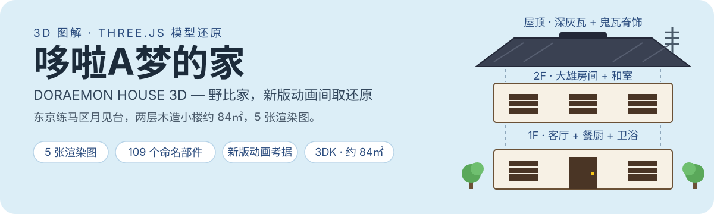
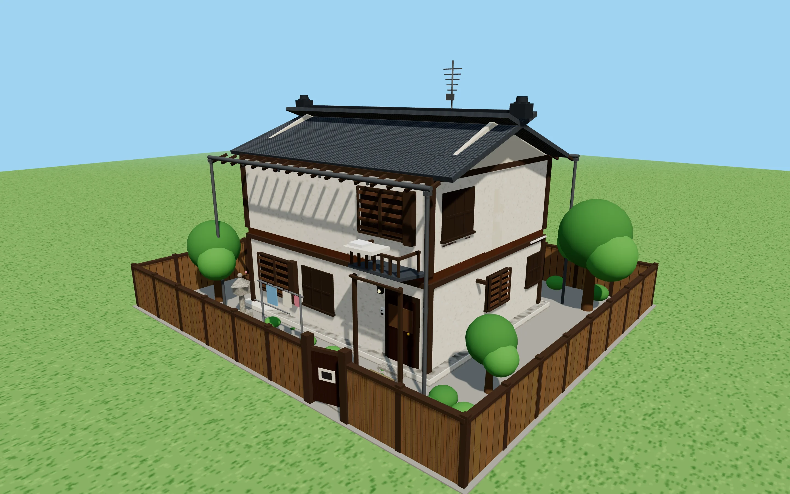
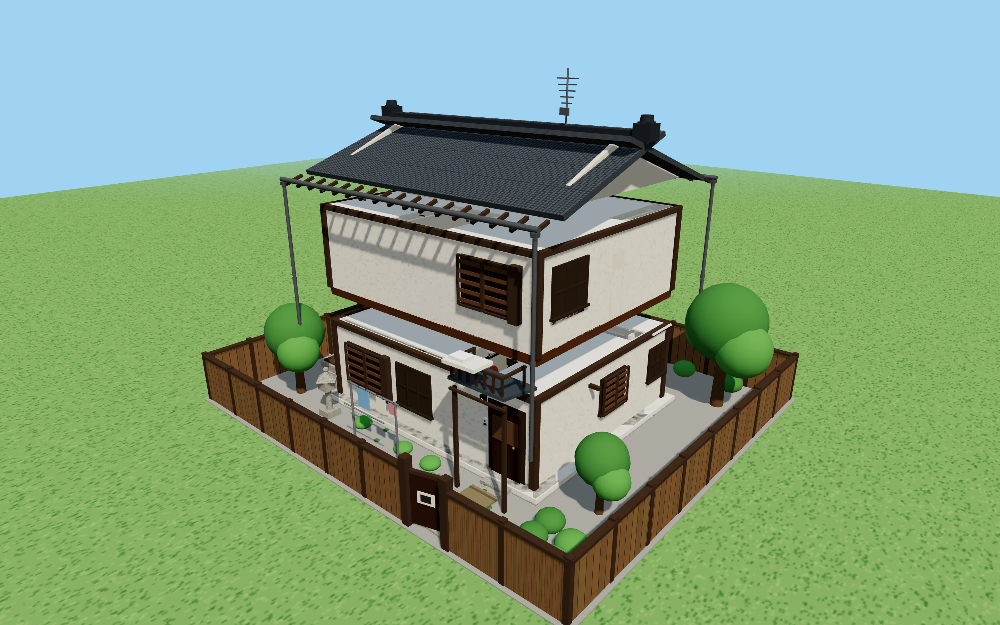
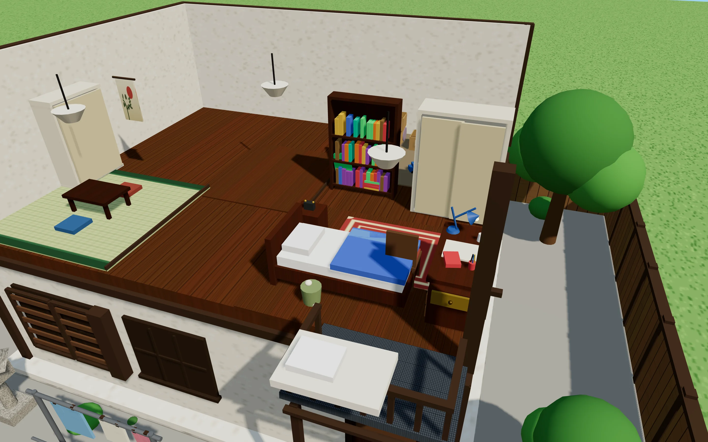

<p align="right"><a href="README.md">中文</a></p>

<p align="center">
  
</p>

<p align="center">
  <a href="https://xiaosang.cc/doraemon-house-3d/">▶ View Online</a>
  ·
  <a href="https://github.com/holynova/doraemon-house-3d">GitHub Repository</a>
</p>

A 3D reconstruction of Nobita Nobi's house from the modern Doraemon anime: a two-storey wooden house (3DK, about 84 m²) in Tsukimidai, Nerima, Tokyo, modelled from the post-2005 anime floor plan and official cutaway art. Five renders cover the exterior, an exploded structural view, both floor cutaways, and a close-up of Nobita's room; click any image for the full size.

## Screenshots

<p align="center">
  
  
  
</p>

## The Five Renders

1. **Exterior overview** — a two-storey Japanese wooden detached house: dark-grey tiled roof, demon-tile ridge ornaments, TV antenna, wooden board fence, a laundry pole in the yard and a canopy over the entrance. Nobita's room window looks onto the roof above the entrance.
2. **Exploded structural view** — roof, second-floor living area and first-floor common space separated vertically, so the 3D layout is clear at a glance.
3. **Second-floor cutaway** — Nobita's room on the east side (6 帖 tatami mats, about 10 m²; the desk drawer is the time machine, the closet is Doraemon's bed), a tatami guest room and storage on the west, a central corridor.
4. **Close-up of Nobita's room** — the east-facing desk (the bottom-right drawer is the time machine entrance), a retro desk lamp, Doraemon's closet bed and the bookshelf.
5. **First-floor cutaway** — an 8-帖 living room (about 13 m²; low table, TV and a Buddhist altar alcove), a 10-帖 kitchen-diner (about 16 m²; cabinets, sink, gas stove and fridge), a sunken entrance shoe cabinet, plus the bathroom and a separate toilet.

## Research Notes

- Based on the **modern anime (post-2005) floor plan**: a 3DK two-storey wooden house, about 83.83 m², cross-checked against fan floor plans and official cutaway art; the research process is documented in `REFERENCE.md`.
- Key faithful details: the desk sits under the window and its bottom-right drawer is the time machine; the closet is Doraemon's bed; Nobita's window looks onto the roof above the entrance; the yard has a wooden board fence (not concrete) and a laundry pole — and no doghouse; the house is rented (借家).
- The model is built from 109 named parts (`app.js`), covering structure, furniture, the yard and small objects.

## View Locally

A pure static page — just open `index.html`, or serve it:

```bash
python3 -m http.server 8000
# Open http://localhost:8000
```

## Tech

- The site is now a static image gallery: 5 renders (PNG + WebP, 2880×1800), click to view full size, dark mode supported.
- The renders come from a Three.js model: `app.js` is the model source of the legacy interactive 3D tour (orbit rotation / floor slicing / camera presets), kept for reference and not referenced by the page.
- `REFERENCE.md`: floor-plan research notes (modern vs classic floor-plan comparison, key detail checklist).

```
index.html          Static gallery page: 5 renders, click to view full size
assets/             Renders (PNG + WebP) and old screenshots
app.js              Legacy interactive Three.js tour source (kept for reference)
REFERENCE.md        Floor-plan research notes
```
