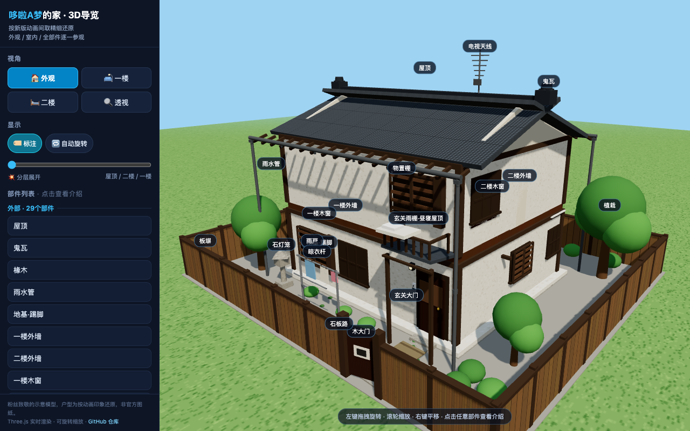

# Doraemon House 3D / 哆啦A梦的家 3D导览

中文：野比大雄家 3D 模型精细图解导览。按新版动画间取精细还原，极简展示房屋外观全景、结构分层展开、一楼与二楼剖面以及大雄房间特写细节。

English: Visual architectural walk-through of Nobita Nobi's house from Doraemon based on 3D reconstruction. Features exterior overview, exploded structural layers, floor cutaways, and detailed room viewpoints.



## 在线体验 / Live Demo

- [在线体验](https://xiaosang.cc/doraemon-house-3d/)
- [GitHub Repo](https://github.com/holynova/doraemon-house-3d)


## 本地运行 / Run locally

```bash
open index.html
```

## 发布 / Deploy

```bash
npx wrangler deploy --config wrangler.jsonc
```

Cloudflare Workers · 路由：`xiaosang.cc/doraemon-house-3d/`（旧子域名 `doraemon-house-3d.xiaosang.cc` 已停用）

注：本站现为静态图片展示；`app.js` 是旧版交互式 3D 导览的模型源码，保留备查，未在页面中引用。

源码与部署配置使用同一个主分支；在本地手动发布，不创建 Cloudflare 专用分支或 GitHub Action。
