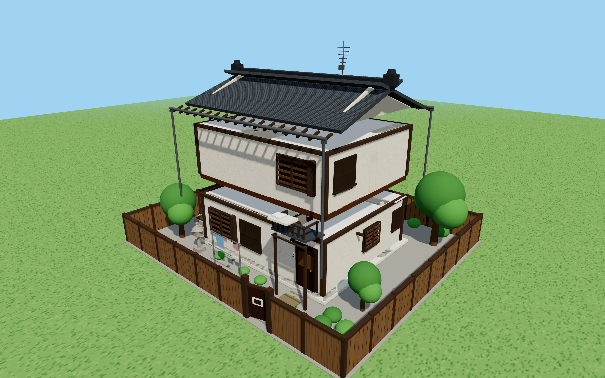
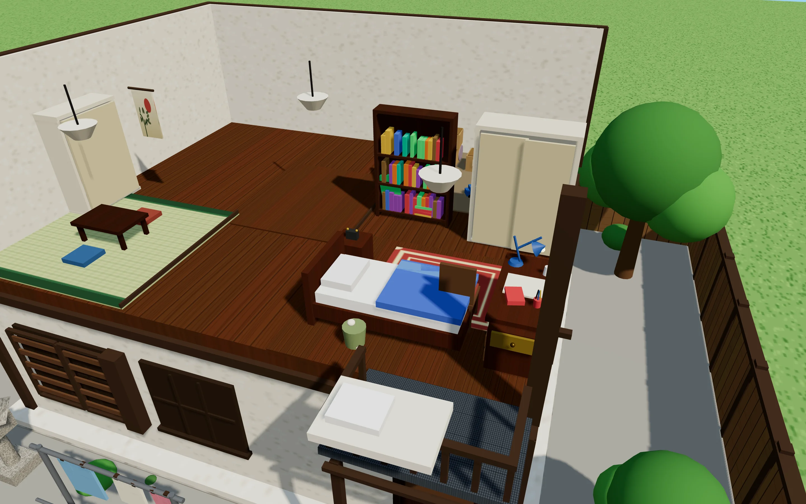

<p align="center">
  
</p>

<p align="center">
  <a href="https://xiaosang.cc/doraemon-house-3d/">▶ 在线看图 View Online</a>
  ·
  <a href="https://github.com/holynova/doraemon-house-3d">GitHub 仓库</a>
</p>

新版《哆啦A梦》动画里野比家的 3D 模型还原：东京练马区月见台的一栋两层木造小楼（3DK，约 84㎡），按新版动画间取与官方剖视图考据建模，共 5 张渲染图——外观全景、结构分层展开、一楼二楼剖面与大雄房间特写，点任意一张可看大图。

A 3D reconstruction of Nobita Nobi's house from the modern Doraemon anime: a two-storey wooden house (3DK, about 84 m²) in Tsukimidai, Nerima, Tokyo, modelled from the post-2005 anime floor plan and official cutaway art. Five renders cover the exterior, an exploded structural view, both floor cutaways, and a close-up of Nobita's room; click any image for the full size.

## 截图 / Screenshots

<p align="center">
  
  
  
</p>

## 五张图 / The Five Renders

1. **外观全景** — 两层日式木造独栋，深灰瓦屋顶、鬼瓦脊饰、电视天线、木板围墙、院落晾衣杆与玄关雨棚。大雄房间窗户正对玄关上方屋顶。
2. **结构分层展开** — 屋顶、二楼生活区与一楼公共起居空间三层垂直分层，立体空间布局一目了然。
3. **二楼剖面** — 东侧大雄房间（6 帖，约 10㎡；书桌抽屉就是时光机，壁橱是哆啦A梦的床），西侧和室客房与储物间，中央走廊。
4. **大雄房间特写** — 朝东的书桌（右下抽屉就是时光机入口）、复古台灯、哆啦A梦睡的壁橱床铺与书架。
5. **一楼剖面** — 8 帖客厅（约 13㎡；矮桌、电视与壁龛佛坛）、10 帖餐厨（约 16㎡；橱柜、水槽、燃气灶与冰箱）、下沉式玄关鞋柜，以及浴室与独立卫生间。

## 考据还原 / Research Notes

- 以**新版动画（2005 年以后）间取**为准：3DK 木造二階建，约 83.83㎡；辅以粉丝平面图与官方剖视图，考据过程见 `REFERENCE.md`。
- 关键还原点：书桌在窗下，右下抽屉是时光机；壁橱是哆啦A梦的床；大雄房间窗下正对玄关上方屋顶；庭院是木板塀围墙（非混凝土）加晾衣杆，无狗屋；房子是借家（租房）。
- 模型以 109 个命名部件搭建（`app.js`），覆盖结构、家具、庭院与小物件。

## 本地查看 / View Locally

纯静态页面，直接打开 `index.html` 即可；或起一个静态服务器：

```bash
python3 -m http.server 8000
# 打开 http://localhost:8000
```

## 技术 / Tech

- 本站现为静态图片展示：5 张渲染图（PNG + WebP 双格式，2880×1800），点图看大图，支持深色模式。
- 渲染图来自 Three.js 模型：`app.js` 是旧版交互式 3D 导览的模型源码（轨道旋转 / 楼层剖切 / 视角切换），保留备查，未在页面中引用。
- `REFERENCE.md`：房型调研笔记（新版 vs 旧版间取对比、关键还原点清单）。

```
index.html          静态图集页面：5 张渲染图，点图看大图
assets/             渲染图（PNG + WebP）与旧截图
app.js              旧版交互式 Three.js 导览源码（保留备查）
REFERENCE.md        房型考据笔记
```

## English

**Doraemon House 3D** is a 3D reconstruction of Nobita Nobi's house from the modern Doraemon anime: a two-storey wooden house (3DK, about 84 m²) in Tsukimidai, Nerima, Tokyo, modelled from the post-2005 anime floor plan and official cutaway art.

- **Five renders**: exterior overview, exploded structural layers (roof / 2F / 1F), the 2F cutaway (Nobita's room + tatami guest room), a close-up of Nobita's room, and the 1F cutaway (living room, kitchen, bath). Click any image for the full 2880×1800 size.
- **Faithful details**: the desk sits under the window and its bottom-right drawer is the time machine; the closet is Doraemon's bed; Nobita's window looks onto the roof above the entrance; the yard has a wooden board fence and a laundry pole — and no doghouse.
- **View it**: open `index.html` — no build step. Dark mode supported.
- **Tech**: a static gallery now; the renders come from a Three.js model (`app.js`, 109 named parts) kept as the legacy interactive tour source. `REFERENCE.md` documents the floor-plan research.
