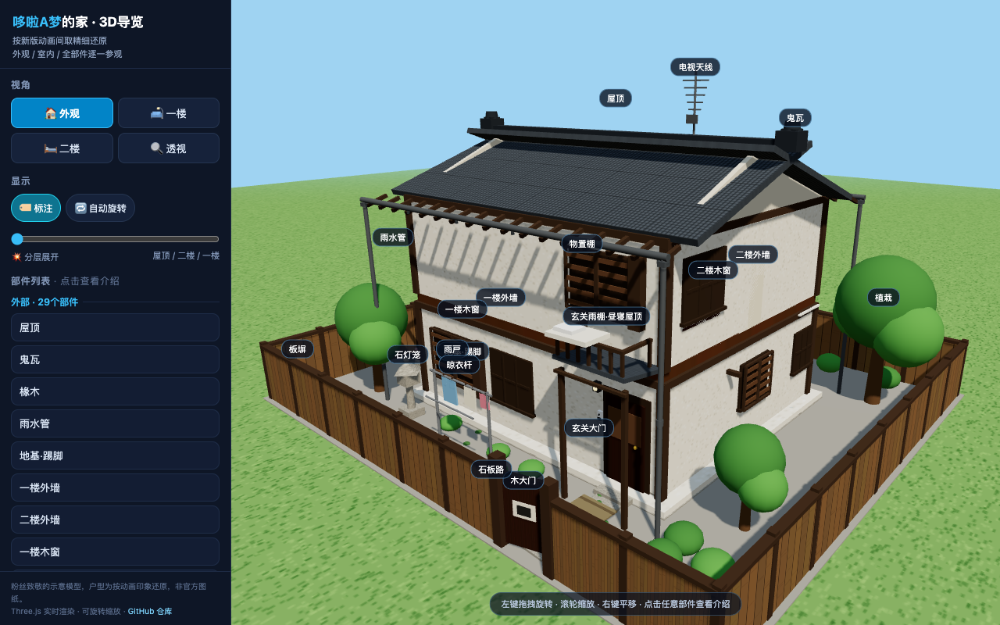

# Doraemon House 3D / 哆啦A梦的家 3D导览

中文：野比大雄家 3D 模型精细图解导览。按新版动画间取精细还原，极简展示房屋外观全景、结构分层展开、一楼与二楼剖面以及大雄房间特写细节。

English: Visual architectural walk-through of Nobita Nobi's house from Doraemon based on 3D reconstruction. Features exterior overview, exploded structural layers, floor cutaways, and detailed room viewpoints.



## 在线体验 / Live Demo

- [Cloudflare Demo](https://doraemon-house-3d.xiaosang.cc/)
- [GitHub Repo](https://github.com/holynova/doraemon-house-3d)


## 本地运行 / Run locally

```bash
open index.html
```

## 发布 / Deploy

```bash
npx wrangler deploy --config wrangler.jsonc
```

Cloudflare Workers · Custom Domain: `doraemon-house-3d.xiaosang.cc`

源码与部署配置使用同一个主分支；在本地手动发布，不创建 Cloudflare 专用分支或 GitHub Action。
